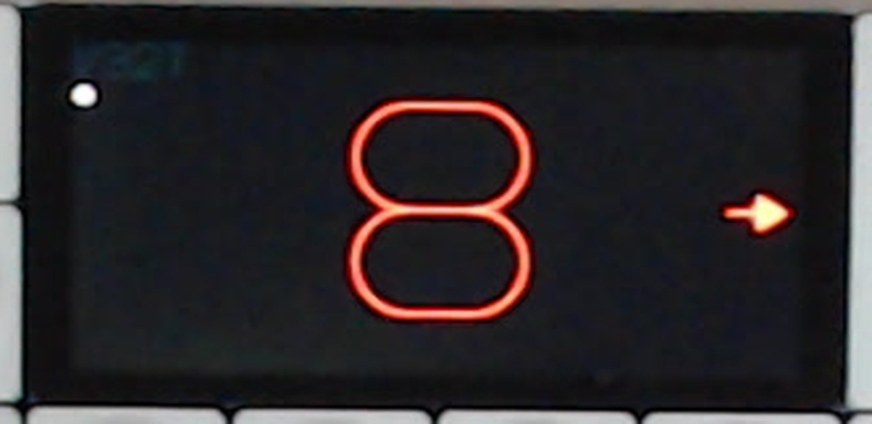

# endless midi

An [open-field](https://github.com/LaP0573/open-field) pack for the OP-1 Field on OS 1.7.3: **record steps of the
unit's own sequencer endless from a MIDI keyboard, at the pitches you play, over the keyboard's whole range.**

On the stock firmware endless is recorded from the unit's own keys, which reach two octaves, and a MIDI keyboard
only plays a sequence. With this pack a sequence can hold any MIDI note, with the velocity it was played at.



*A photo of the unit's screen: endless's own screen with shift held, after eight notes came in over MIDI. The red number
counts the steps.*

Version 6. It needs open-field with `base.pack` (level 5; open-field 0.12 or later).

## How to use it

Exactly as you record endless from the unit's keys, but on the MIDI keyboard:

1. A synth sound, with **endless picked as its sequencer** (shift + sequencer opens the list).
2. The sequencer key: endless's screen shows, and the sequencer is switched on. (Pressed again on that screen it
   switches the sequencer off, `SEQ OFF`: then nothing is recorded.) Latch off.
3. Hold the unit's **shift** and play the MIDI keyboard. Each note sounds at its own pitch and is recorded; the
   screen's red number counts the steps. Notes held together make one step (up to four notes). As always, **the
   first note of a new recording clears the sequence that was there.**
4. Let go of shift.
5. Play the sequence as always. **Holding the unit's lower C plays it at the pitches you recorded** (with the
   octave where it was when you recorded). Any other key moves the whole sequence, as it does for every endless
   sequence.

Without shift, and on every other screen, MIDI goes exactly as it did.

## What it changes in the unit

Three functions of the firmware get a jump at their first instruction (`0x8f00875c`, `0x8f00866c`, `0x8fc9f9e4`):
MIDI note-on, MIDI note-off, and the small function that turns a note key into its semitone. While shift is held on
endless's screen, a MIDI note is handed to the unit as the press of a spare note key, and for as long as that key is
down the pack tells endless's recorder the note's real pitch in place of the key's. Everything else in those
functions runs as it came.

The sequence that results is an ordinary endless sequence. The unit saves it, loads it and plays it without this
pack.

## Good to know

- **Synth only.** On the drum nothing changes.
- Rest and delete-step are still the unit's own keys.
- The unit's screen and lights show the spare key the pack used, not the note you played.
- If you press one of the unit's own note keys while MIDI notes are held with shift, a MIDI note that borrowed that
  key is cut short.
- A note that would land above the top or under the bottom of MIDI after you move the sequence is not played.
- If the keyboard's cable comes out while a key is down with shift held, that note rings until you leave
  endless's screen. Afterwards play that same note once more, without shift, and all is as before.

## Its lines in the unit's log

Tag `endless_midi`. One line at the start:

```
endless midi: on (version 6). MIDI notes become endless's steps while shift is held on its screen (the sequencer on, endless picked for the synth); places 8f00875c 8f00866c 8fc9f9e4
```

No line for a note. After notes were recorded, one line of counts, two seconds after the last of them (or once a
minute while recording goes on without a rest):

```
endless midi: counts: 8 downs 8 ups handed on, 8 keys given back, 32 questions answered, 0 from other callers left to the firmware; 0 no key free, 0 down again, 0 freed late, 0 ended latched, 0 note-offs for both; notes left to the firmware 0 on 0 off; lent now 00000000, ups owed 00000000
```

Plain playing over MIDI writes nothing.

## Status

**Tried on a unit** on 2026-11-25: OS 1.7.3, open-field 0.21 (base 39), with 21 other packs on the unit. The tests
were run by remote control over USB: keys sent as MIDI, the unit's log, and a webcam on the screen. The notes came
from a computer, on the unit's own MIDI channel.

- On endless's screen with shift held, eight MIDI notes from 29 to 101 were recorded: the screen's count went from 0
  to 8, and with the lower C held the unit played back exactly those eight, at the velocity they were sent with.
- A sequence of four steps with two chords and soft velocities, read out before the test, was recorded back through
  the pack and came out note for note and velocity for velocity.
- Forty MIDI notes played on endless's screen without shift left the sequence as it was.
- The log held the one line of the start and one line of counts after each recording, with no fault counted, and
  nothing for a note.
- Version 5, the same code with test lines in the log, did the same on open-field 0.19 (base 37).

**Not tried:** a MIDI keyboard in the hand (and one on another channel than the unit's), the drum side (nothing
should change there), latch, a cable pulled with a key down.

## If something goes wrong

- A note that will not stop: leave endless's screen and come back. If it stays, play the same note again on the
  MIDI keyboard without shift. If it still stays, switch off and on.
- Take it off: delete `endless midi.pack` from the unit's `packs` folder in disk mode and restart.
- If the unit does not start with it: hold the **help** key while switching on. The unit then starts with no packs,
  and you can delete `endless midi.pack` in disk mode.

## Files

| File | What |
| --- | --- |
| `endless midi.pack` | The pack, version 6: copy it into the unit's `packs` folder |
| `source/recipe.json` | Its name, version, sources and card |
| `source/profile.json` | Its three places in the firmware: address, length and checksum. No byte of the firmware |
| `source/endless_midi_table.s`, `source/endless_midi_card.s` | Its table of changes and its card, made by open-field's tools |
| `source/endless_midi_stubs.s` | The three routines at the firmware's functions |
| `source/endless_midi.cpp` | The pack |
| `media/` | A photo of the unit's screen |
| `LICENSE` | The MIT licence |

## Install

Tick it on open-field's install page once it is listed there, or copy `endless midi.pack` into the unit's `packs`
folder in disk mode and restart.

## Build

Copy `source/` into an open-field tree as `examples/endless_midi/`, then:

```bash
python -I tools/pack_build.py build3 --recipe examples/endless_midi/recipe.json --profile examples/endless_midi/profile.json --out out/endless-midi.pack
```

Built this way against open-field 0.21, it comes out byte for byte as the file here.

Unofficial; not made, endorsed or supported by Teenage Engineering. MIT licence.
